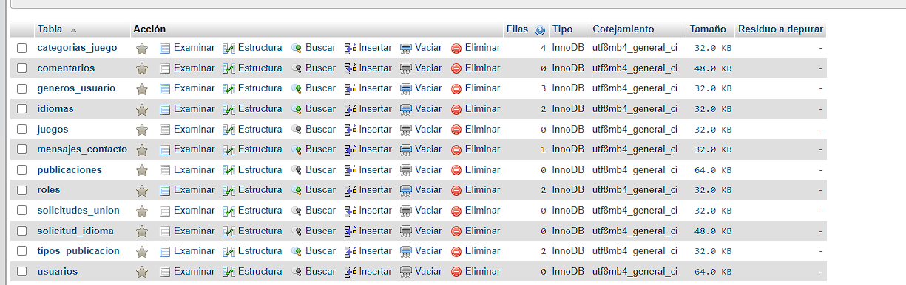
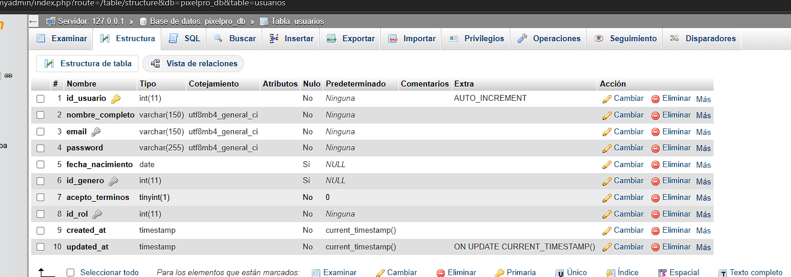

# PixelPro — TP6

**Proyecto:** Portal gamer PixelPro · Integrador de Programación Web TP4–TP8.

**Instalación previa:** colocar `PixelPro/` en `C:\xampp\htdocs\`, encender Apache y MySQL, importar `PixelPro/database/schema.sql` en phpMyAdmin y configurar `PixelPro/config/.env` a partir de `.env.example` sin compartir las credenciales. Abrir `http://localhost/PixelPro/`.

## Objetivo

Diseñar una base relacional normalizada y relacionar las entidades mediante claves primarias y foráneas.

## Implementación

- `database/schema.sql`: crea `pixelpro_db` y las tablas, entre ellas `usuarios`, `roles`, `juegos`, `categorias_juego`, `publicaciones`, `comentarios`, `solicitudes_union`, `solicitud_idioma` y `mensajes_contacto`.
- `database/normalizacion.md`: explica 1FN, 2FN y 3FN con un ejemplo de publicaciones y comentarios.
- `database/consultas.sql`: contiene consultas SQL de demostración; **es material orientativo del TP y no debe importarse a ciegas sobre datos reales**.

### 1. Tablas de la base de datos

En esta captura se observa la estructura general de la base de datos `pixelpro_db`, con las tablas utilizadas por el proyecto.

### 2. Estructura de la tabla

Esta captura muestra los campos de una tabla, sus tipos de datos y la configuración correspondiente en phpMyAdmin.

